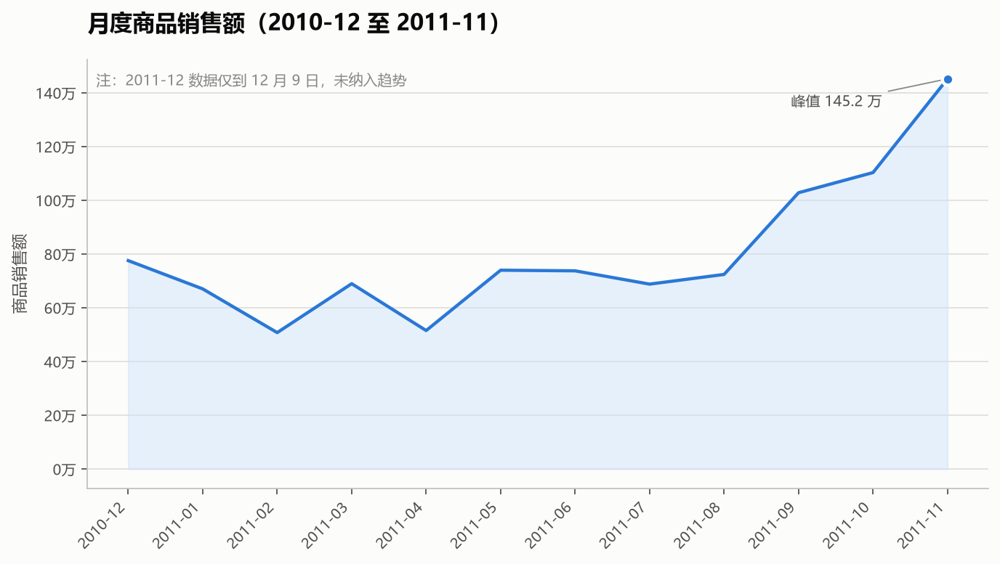
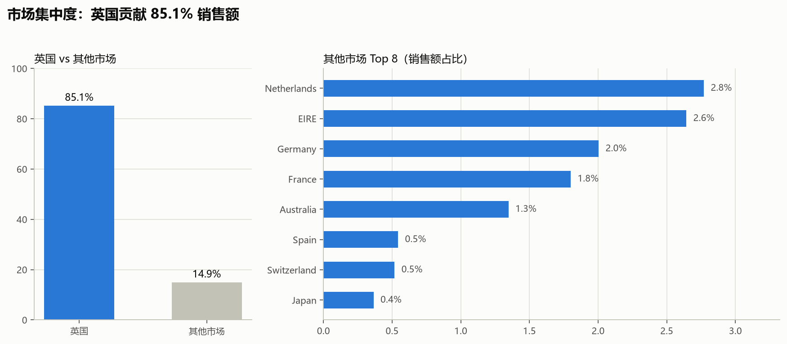
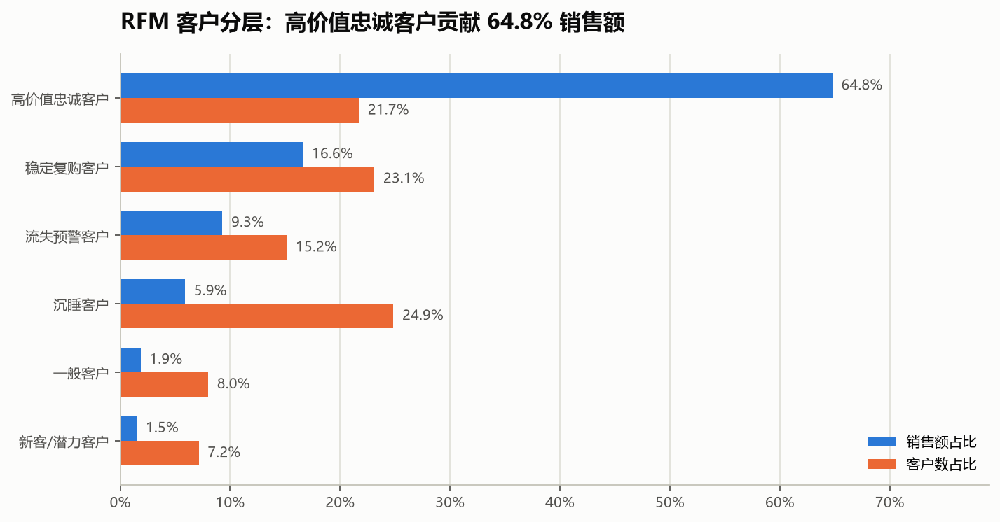
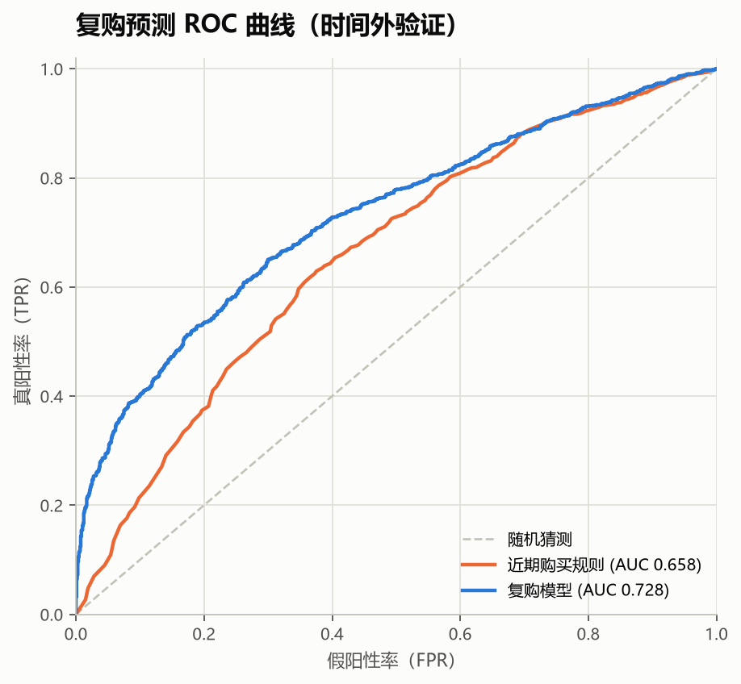
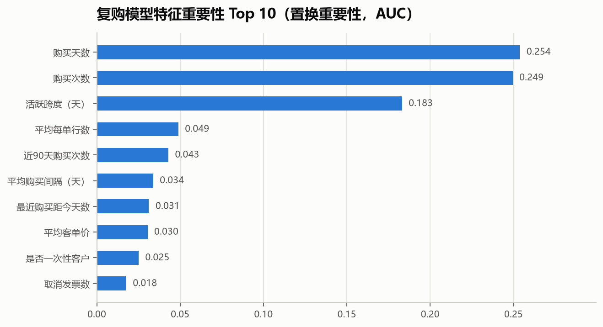

# 电商零售用户分析与复购预测


> 用 54 万条真实交易数据，完成从数据清洗、业务分析、RFM 客户分层、复购预测到交互看板的完整数据科学项目。

**30 秒了解项目**

- 清洗 54.2 万条交易 → 52.3 万条有效商品销售
- 商品销售额 1,024.8 万，订单 19,773 笔，客户 4,334 人
- 英国贡献 85.14% 销售额，Top 10% 客户贡献 61.37%
- 复购模型时间外测试 AUC 0.728，Top 10% 精确率 96.0%
- 交付 5 张图表、完整报告、Streamlit 看板

[核心结果](#核心结果) · [图表](#图表) · [快速开始](#快速开始) · [复购模型](#复购模型) · [完整报告](reports/analysis_report.md) · [简历描述](docs/resume_bullets.md)

> 不想跑代码？直接看 [完整分析报告](reports/analysis_report.md) 和 [图表目录](reports/figures/)。

## 面试官快速看

| 想看什么 | 去哪里 |
|---|---|
| 核心结论与业务建议 | [完整分析报告](reports/analysis_report.md) |
| 清洗口径与代码 | [src/cleaning.py](src/cleaning.py) |
| 复购模型 | [src/repurchase.py](src/repurchase.py) |
| 交互看板 | [app/dashboard.py](app/dashboard.py) |
| 简历项目描述 | [docs/resume_bullets.md](docs/resume_bullets.md) |
| 面试追问准备 | [docs/interview_qa.md](docs/interview_qa.md) |

## 项目亮点

- **端到端**：清洗 → 指标分析 → RFM → 建模 → 看板 → 报告，全流程可复现。
- **数据质量**：识别并处理重复行、取消发票、库存调整、匿名客户和非商品编码，避免把邮费当成热销商品。
- **业务价值**：量化英国市场集中度、客户集中度、商品集中度和复购结构，输出可执行运营建议。
- **模型严谨性**：按时间切分训练/测试，训练集 5 折交叉验证选型，测试集用于最终评估；与规则基线对比。

## 核心结果

| 指标 | 结果 |
|---|---:|
| 原始交易行 | 541,909 |
| 去重后行数 | 536,641 |
| 有效商品销售行 | 522,569 |
| 商品销售额 | 10,247,907.68 |
| 订单数 | 19,773 |
| 有 ID 客户数 | 4,334 |
| 客单价 | 518.28 |
| 复购率 | 65.27% |
| 英国销售额占比 | 85.14% |
| Top 10% 客户销售额占比 | 61.37% |
| Top 20% 商品销售额占比 | 78.83% |
| 商品退货率（金额口径） | 4.44% |
| 复购模型测试 AUC | 0.728（CV 0.756） |
| Top 10% 高风险客户精确率 | 96.0%（Lift 1.56） |

> 销售额单位为原始数据货币单位；有效销售已排除取消发票、非商品编码、负数量和异常价格。

## 图表

### 月度销售额



### 市场集中度



### RFM 客户分层



### 复购模型





## 项目结构

```
retail-analysis/
├── app/
│   └── dashboard.py              # Streamlit 交互看板
├── data/
│   ├── raw/                      # 原始 Excel（不入库）
│   └── processed/                # Parquet 中间数据（不入库，可重新生成）
├── models/
│   └── repurchase_model.joblib   # 复购模型
├── notebooks/
│   └── 01_load_and_inspect.ipynb # 数据加载与初探
├── reports/
│   ├── analysis_report.md        # 完整分析报告
│   ├── cleaning_summary.json     # 清洗口径与数量
│   ├── kpis.json                 # 核心指标
│   ├── model_metrics.json        # 模型指标
│   ├── feature_importance.csv
│   ├── roc_curve.csv
│   └── figures/                  # 图表
├── src/
│   ├── cleaning.py               # 数据清洗
│   ├── rfm.py                    # RFM 分层
│   ├── features.py               # 复购特征工程
│   ├── repurchase.py             # 模型训练与评估
│   └── analysis.py               # 业务分析、图表、报告
├── docs/
│   ├── resume_bullets.md         # 简历项目描述
│   └── interview_qa.md           # 面试追问准备
├── requirements.txt
└── README.md
```

## 快速开始

### 1. 克隆并创建环境

```bash
git clone <your-repo-url>
cd retail-analysis

# macOS / Linux 用 python3.12；Windows 也可以用 py -3.12
python3.12 -m venv .venv
```

激活虚拟环境：

```bash
# macOS / Linux
source .venv/bin/activate

# Windows Git Bash
source .venv/Scripts/activate

# Windows PowerShell
.venv\Scripts\Activate.ps1
```

安装依赖：

```bash
pip install -r requirements.txt
```

### 2. 下载数据

```bash
mkdir -p data/raw
curl -L -o "data/raw/online_retail.zip" \
  "https://archive.ics.uci.edu/static/public/352/online+retail.zip"
```

解压得到 `data/raw/Online Retail.xlsx`：

- macOS / Linux / Git Bash：`unzip data/raw/online_retail.zip -d data/raw/`
- Windows PowerShell：`Expand-Archive data/raw/online_retail.zip -DestinationPath data/raw/`

原始数据不提交到 Git。

### 3. 运行流水线

```bash
# 1. 清洗：生成销售、取消、库存调整、服务费四张表
python -m src.cleaning

# 2. RFM 客户分层
python -m src.rfm

# 3. 复购模型：生成模型指标、ROC、特征重要性
python -m src.repurchase

# 4. 业务分析、图表、报告
python -m src.analysis
```

每一步都会把结果写入 `data/processed/` 和 `reports/`，可单独重跑。

### 4. 启动看板

```bash
streamlit run app/dashboard.py
```

看板支持按日期范围和国家/地区筛选，展示 KPI、月度趋势、国家分布、RFM 分层和复购风险名单。

### 5. 打开 Notebook

```bash
python -m jupyter notebook
```

选择内核 **Python 3.12 (retail-analysis)**。如果没有该内核，执行：

```bash
python -m ipykernel install --user \
  --name ds-python312 \
  --display-name "Python 3.12 (retail-analysis)"
```

## 数据与口径

### 数据字段

| 字段 | 含义 |
|---|---|
| `InvoiceNo` | 发票号，以 `C` 开头表示取消/退货 |
| `StockCode` | 商品编码 |
| `Description` | 商品名称 |
| `Quantity` | 数量，负数表示退货或调整 |
| `InvoiceDate` | 交易时间 |
| `UnitPrice` | 单价 |
| `CustomerID` | 客户编号，缺失表示匿名交易 |
| `Country` | 国家/地区 |

### 清洗规则

1. 去除完全重复行 **5,268** 行。
2. 文本字段统一为字符串类型，避免 Parquet 写入时混合类型报错。
3. 拆分四类数据：
   - **正常商品销售**：数量 > 0、单价 > 0、非取消发票、非非商品编码。
   - **取消/退货**：`InvoiceNo` 以 `C` 开头的发票。
   - **库存调整**：非 `C` 发票的负数量记录。
   - **邮费/手续费**：`POST`、`DOT`、`M`、`C2`、`D`、`S`、`B`、`PADS`、`CRUK`、`BANK CHARGES`、`AMAZONFEE`。
4. 商品分析排除非商品编码；客户分析排除 `CustomerID` 缺失的匿名交易。

### 指标定义

| 指标 | 定义 |
|---|---|
| 商品销售额 | `Quantity × UnitPrice`，仅有效商品销售 |
| 订单数 | 去重 `InvoiceNo` |
| 客户数 | 去重 `CustomerID`（排除缺失） |
| 复购率 | 统计期内下单次数 ≥ 2 的客户 / 有 ID 客户 |
| 退货率（金额） | 商品取消金额 /（商品销售额 + 商品取消金额） |
| Top 10% 客户占比 | 按销售额排序后前 10% 客户的销售额占比 |
| RFM | R 最近购买间隔、F 去重发票数、M 销售额；各维度分位数打 1-5 分 |

## 复购模型

### 特征与标签

- **特征窗口**：快照日前 **180 天**。
- **标签窗口**：快照日后 **90 天**内是否再次购买。
- **训练快照**：2011-06-09（2,625 人，复购率 49.90%）。
- **测试快照**：2011-09-09（2,775 人，复购率 61.51%）。
- **特征数**：23 个，包括 R/F/M、购买间隔、近 90 天活跃度、取消行为、客户年龄等。

### 验证方式

- 按时间切分，而不是随机切分，模拟“用过去预测未来”。
- 模型选择只使用训练集的 5 折交叉验证；测试集用于最终评估。
- 与“只按最近购买时间排序”的规则基线对比。

### 结果

| 模型 | 交叉验证 AUC | 测试 AUC | PR-AUC | Top 10% 精确率 | Lift |
|---|---:|---:|---:|---:|---:|
| 逻辑回归 | 0.756 | 0.728 | 0.824 | 96.0% | 1.56 |
| 梯度提升树 | 0.718 | 0.701 | 0.805 | 95.3% | 1.55 |
| 近期购买规则 | — | 0.658 | 0.728 | 77.6% | 1.26 |

### 关键特征

置换重要性 Top 5：购买天数、购买次数、活跃跨度、平均每单行数、近 90 天购买次数。

含义：**持续、频繁、近期活跃**的客户更可能复购；单纯“买得多”不如“买得频繁且最近还在买”。

## 业务结论

1. **英国是基本盘**：贡献 85.14% 销售额；海外优先测试荷兰、爱尔兰、德国、法国。
2. **客户价值高度集中**：Top 10% 客户贡献 61.37% 销售额；高价值忠诚客户占 21.71% 人数、贡献 64.78% 销售额。
3. **流失预警客户值得召回**：657 人贡献 9.30% 销售额，适合定向优惠和专属服务。
4. **商品策略不能只看销售额**：Top 20% 商品贡献 78.83% 销售额，但部分“爆款”来自一次性大单，需要同时看订单数和复购。
5. **Q4 旺季明显**：11 月销售额达到 145.2 万，备货和营销资源应向 Q4 倾斜。

## 局限性

- 数据来自单一英国零售商，时间范围为 2010-2011，结论不能直接外推到当前市场。
- 只有交易数据，没有成本、利润、流量和广告投放数据，无法计算 ROI 或做因果推断。
- 复购模型是历史回测；测试期复购率（61.51%）高于训练期（49.90%），存在季节性分布漂移，上线前需要重新校准概率并做 A/B 测试。
- RFM 分层基于固定快照日，客户会随时间迁移，建议按月重算。

## 相关文档

- [完整分析报告](reports/analysis_report.md)
- [简历项目描述](docs/resume_bullets.md)
- [面试追问准备](docs/interview_qa.md)

## 数据来源

[UCI Machine Learning Repository — Online Retail](https://archive.ics.uci.edu/dataset/352/online+retail)

本项目仅用于学习与作品集展示，数据版权归原始数据集作者所有；分析结论不代表真实企业经营情况。
